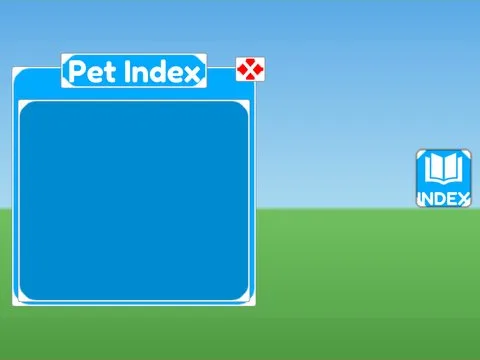

# Pet Index · Hatching Simulator

Interface « Pet Index » du jeu Hatching Simulator. 22 éléments UI.

- **Catégorie** : [Interfaces](../Interfaces.md)
- **Sous-catégorie** : [Index & collection](Index%20&%20collection.md)
- **Type** : Interface (ScreenGui)
- **Contenu** : 22 éléments UI
- **Jeu d'origine** : Hatching Simulator
- **Fichier source** : `ui/ByType/Index_Collection/HatchingSim_PetIndex.rbxm` (dans ta bibliothèque `rblx\lib`)
