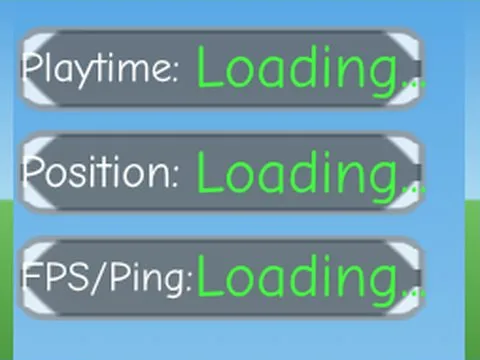

# Debug Mode · Hatching Simulator

Interface « Debug Mode » du jeu Hatching Simulator. 13 éléments UI.

- **Catégorie** : [Interfaces](../Interfaces.md)
- **Sous-catégorie** : [Interfaces de jeux](Interfaces%20de%20jeux.md)
- **Type** : Interface (ScreenGui)
- **Contenu** : 13 éléments UI
- **Jeu d'origine** : Hatching Simulator
- **Fichier source** : `ui/FromGames/HatchingSimulator/DebugMode.rbxm` (dans ta bibliothèque `rblx\lib`)
