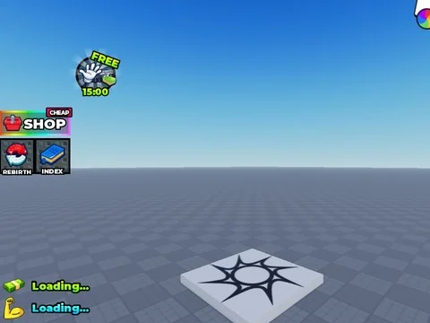

# Drill For LuckyBlocks – interfaces

4 ScreenGui/éléments extraits du StarterGui de Drill For LuckyBlocks (un .rbxm par enfant).

- **Catégorie** : [Interfaces](../Interfaces.md)
- **Sous-catégorie** : [Interfaces de jeux](Interfaces%20de%20jeux.md)
- **Type** : Interface (ScreenGui)
- **Contenu** : 4 fichiers · 0,2 Mo
- **Jeu d'origine** : Drill For LuckyBlocks
- **Fichier source** : `Assets/ui/FromGames/Drill For LuckyBlocks` (dans le vault)

## Fichiers (4)

- `LocalScript.rbxm`
- `MainGUI.rbxm`
- `Notification.rbxm`
- `Popups.rbxm`
