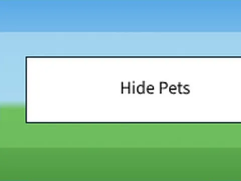
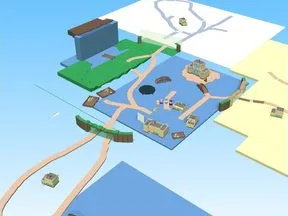
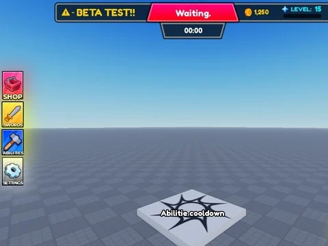
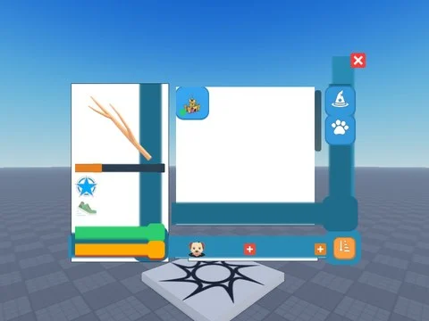
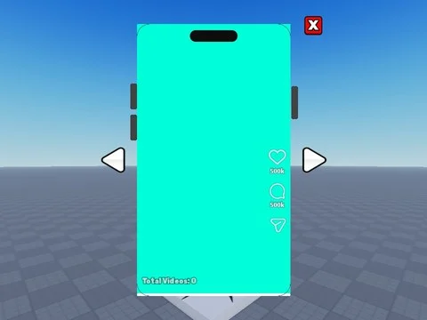

# Interfaces de jeux

Sous-catégorie de [Interfaces](../Interfaces.md) · **24 éléments**

| Aperçu | Élément | Infos |
| --- | --- | --- |
|  | [Debug Mode · Hatching Simulator](Debug%20Mode%20%C2%B7%20Hatching%20Simulator%20%C2%B7%20Interfaces%20de%20jeux.md) | Interface (ScreenGui) · 13 éléments UI |
|  | [Event Text · Tapping Lords](Event%20Text%20%C2%B7%20Tapping%20Lords.md) | Interface (ScreenGui) · 3 éléments UI |
|  | [Experiment · Tapping Lords](Experiment%20%C2%B7%20Tapping%20Lords.md) | Interface (ScreenGui) · 1 élément UI |
|  | [Mouse Hover · Bakery Simulator](Mouse%20Hover%20%C2%B7%20Bakery%20Simulator.md) | Interface (ScreenGui) · 1 élément UI |
|  | [Piano Gui · First Donations](Piano%20Gui%20%C2%B7%20First%20Donations.md) | Interface (ScreenGui) · 131 éléments UI |
|  | [Shop Gui · Billionaire Tycoon](Shop%20Gui%20%C2%B7%20Billionaire%20Tycoon%20%C2%B7%20Interfaces%20de%20jeux.md) | Interface (ScreenGui) · 74 éléments UI |
|  | [UI · Cashgrab Bridge](UI%20%C2%B7%20Cashgrab%20Bridge.md) | Interface (ScreenGui) · 2 éléments UI |
|  | [Interfaces · Bakery Simulator (2)](Interfaces%20%C2%B7%20Bakery%20Simulator%20%282%29.md) | Pack de fichiers · 2 fichiers · 12 Ko |
|  | [Interfaces · Cashgrab Bridge (2)](Interfaces%20%C2%B7%20Cashgrab%20Bridge%20%282%29.md) | Pack de fichiers · 2 fichiers · 22 Ko |
|  | [Interfaces · First Donations (2)](Interfaces%20%C2%B7%20First%20Donations%20%282%29.md) | Pack de fichiers · 2 fichiers · 16 Ko |
|  | [Interfaces · Glass Bridge (3)](Interfaces%20%C2%B7%20Glass%20Bridge%20%283%29.md) | Pack de fichiers · 3 fichiers · 45 Ko |
|  | [Interfaces · Hatching Simulator (1)](Interfaces%20%C2%B7%20Hatching%20Simulator%20%281%29.md) | Pack de fichiers · 1 fichier · 3 Ko |
|  | [Interfaces · Pet Pharmica (2)](Interfaces%20%C2%B7%20Pet%20Pharmica%20%282%29.md) | Pack de fichiers · 2 fichiers · 21 Ko |
|  | [Interfaces · Punch Simulator (5)](Interfaces%20%C2%B7%20Punch%20Simulator%20%285%29.md) | Pack de fichiers · 5 fichiers · 28 Ko |
|  | [Interfaces · Tapping Lords (5)](Interfaces%20%C2%B7%20Tapping%20Lords%20%285%29.md) | Pack de fichiers · 5 fichiers · 73 Ko |
|  | [Interfaces · Tweeting Simulator (1)](Interfaces%20%C2%B7%20Tweeting%20Simulator%20%281%29.md) | Pack de fichiers · 1 fichier · 14 Ko |
|  | [Interfaces · Magnet Simulator 2 (1)](Interfaces%20%C2%B7%20Magnet%20Simulator%202%20%281%29.md) | Pack de fichiers · 1 fichier · 5 Ko |
|  | [Drill For LuckyBlocks – interfaces](Drill%20For%20LuckyBlocks%20%E2%80%93%20interfaces.md) | Interface (ScreenGui) · 4 fichiers · 0,2 Mo |
|  | [Roll A Brainrot (ZEVR) – interfaces](Roll%20A%20Brainrot%20%28ZEVR%29%20%E2%80%93%20interfaces.md) | Interface (ScreenGui) · 1 fichier · 32 Ko |
|  | [MiniGame (combat à l’épée par manches) – interfaces](MiniGame%20%28combat%20%C3%A0%20l%E2%80%99%C3%A9p%C3%A9e%20par%20manches%29%20%E2%80%93%20interfaces.md) | Interface (ScreenGui) · 2 fichiers · 60 Ko |
|  | [Unboxing Simulator – interfaces](Unboxing%20Simulator%20%E2%80%93%20interfaces.md) | Interface (ScreenGui) · 16 fichiers · 0,1 Mo |
|  | [Steal An Egg (place 107778070777162) – interfaces](Steal%20An%20Egg%20%28place%20107778070777162%29%20%E2%80%93%20interfaces.md) | Interface (ScreenGui) · 66 fichiers · 1,0 Mo |
|  | [Steal An Egg – Better Version (clstudioo) – interfaces](Steal%20An%20Egg%20%E2%80%93%20Better%20Version%20%28clstudioo%29%20%E2%80%93%20interfaces.md) | Interface (ScreenGui) · 66 fichiers · 1,2 Mo |
|  | [Steal An Egg Sourced – interfaces](Steal%20An%20Egg%20Sourced%20%E2%80%93%20interfaces.md) | Interface (ScreenGui) · 77 fichiers · 1,5 Mo |
