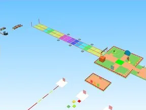

# Interfaces · Glass Bridge (3)

Interfaces du jeu Glass Bridge pas encore dans le vault : Jumpscare, ScreenGui, TrollMenu.

- **Catégorie** : [Interfaces](../Interfaces.md)
- **Sous-catégorie** : [Interfaces de jeux](Interfaces%20de%20jeux.md)
- **Type** : Pack de fichiers
- **Contenu** : 3 fichiers · 45 Ko
- **Jeu d'origine** : Glass Bridge
- **Fichier source** : `Assets/ui/FromGames/GlassBridge` (dans le vault)

## Fichiers (3)

- `Jumpscare.rbxm`
- `ScreenGui.rbxm`
- `TrollMenu.rbxm`
