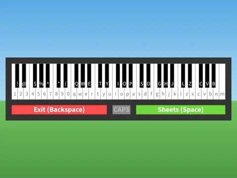

# Piano Gui · First Donations

Interface « Piano Gui » du jeu First Donations. 131 éléments UI.

- **Catégorie** : [Interfaces](../Interfaces.md)
- **Sous-catégorie** : [Interfaces de jeux](Interfaces%20de%20jeux.md)
- **Type** : Interface (ScreenGui)
- **Contenu** : 131 éléments UI
- **Jeu d'origine** : First Donations
- **Fichier source** : `ui/FromGames/First_Donations/PianoGui.rbxm` (dans ta bibliothèque `rblx\lib`)
