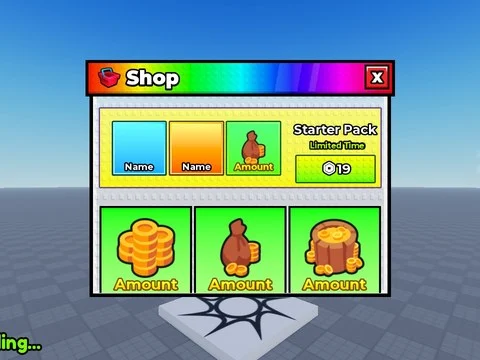

# Roll A Brainrot (ZEVR) – interfaces

1 ScreenGui/éléments extraits du StarterGui de Roll A Brainrot (ZEVR) (un .rbxm par enfant).

- **Catégorie** : [Interfaces](../Interfaces.md)
- **Sous-catégorie** : [Interfaces de jeux](Interfaces%20de%20jeux.md)
- **Type** : Interface (ScreenGui)
- **Contenu** : 1 fichier · 32 Ko
- **Jeu d'origine** : Roll A Brainrot
- **Fichier source** : `Assets/ui/FromGames/Roll A Brainrot ZEVR` (dans le vault)

## Fichiers (1)

- `GUI.rbxm`
