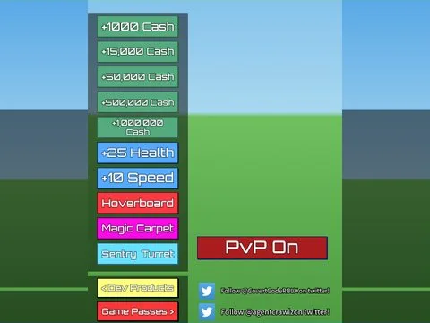

# Shop Gui · Billionaire Tycoon

Interface « Shop Gui » du jeu Billionaire Tycoon. 74 éléments UI.

- **Catégorie** : [Interfaces](../Interfaces.md)
- **Sous-catégorie** : [Interfaces de jeux](Interfaces%20de%20jeux.md)
- **Type** : Interface (ScreenGui)
- **Contenu** : 74 éléments UI
- **Jeu d'origine** : Billionaire Tycoon
- **Fichier source** : `ui/FromGames/Billionaire_Tycoon/ShopGui.rbxm` (dans ta bibliothèque `rblx\lib`)
