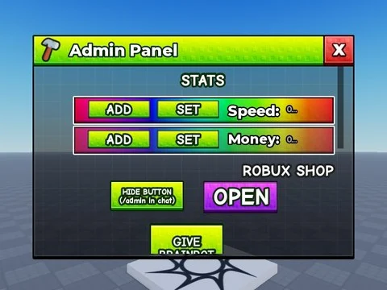

# Steal An Egg Sourced – interfaces

77 ScreenGui/éléments extraits du StarterGui de Steal An Egg Sourced (un .rbxm par enfant).

- **Catégorie** : [Interfaces](../Interfaces.md)
- **Sous-catégorie** : [Interfaces de jeux](Interfaces%20de%20jeux.md)
- **Type** : Interface (ScreenGui)
- **Contenu** : 77 fichiers · 1,5 Mo
- **Jeu d'origine** : Steal An Egg
- **Fichier source** : `Assets/ui/FromGames/Steal An Egg Sourced` (dans le vault)

## Fichiers (77)

- `AdminToast.rbxm`
- `AreaGui.rbxm`
- `AssetEggData.rbxm`
- `AssetHoverData.rbxm`
- `AutoSell.rbxm`
- `BackpackGui.rbxm`
- `BaseUpgradeTransitionGui.rbxm`
- `BottomUI.rbxm`
- `Click Effect.rbxm`
- `Cmdr.rbxm`
- `Codes.rbxm`
- `CustomSpeedSystem.rbxm`
- `Damage.rbxm`
- `DistanceProgression.rbxm`
- `DropHeldEgg.rbxm`
- `Elements.rbxm`
- `Fade.rbxm`
- `Fps.rbxm`
- `Frames.rbxm`
- `FreeGifts.rbxm`
- `FriendBoost.rbxm`
- `Friend_Notification.rbxm`
- `FuseMachine.rbxm`
- `GUIFX Holder.rbxm`
- `GameResetTimer.rbxm`
- `GearShop.rbxm`
- `GetMoreSpeedOnHit.rbxm`
- `GiftNotification.rbxm`
- `GroupReward.rbxm`
- `GrowingEggList.rbxm`
- `Hud.rbxm`
- `Index.rbxm`
- `LikeBoardGui.rbxm`
- `LikeGameBanner.rbxm`
- `LimitedStarterPackOffer.rbxm`
- `Message.rbxm`
- `Money.rbxm`
- `Notifications.rbxm`
- `Odds_UI.rbxm`
- `OfflineCashAndAssetLevelGrew.rbxm`
- `OfflineCashOnly.rbxm`
- `OfflineMoneyInPlot.rbxm`
- `PetList.rbxm`
- `Rebirth.rbxm`
- `ResetStartTimer.rbxm`
- `RunBackEffects.rbxm`
- `RunButton.rbxm`
- `RunCharge.rbxm`
- `Settings.rbxm`
- `ShiftLockButton.rbxm`
- `Shop.rbxm`
- `SpeedGainAnimation.rbxm`
- `SpeedValue.rbxm`
- `StaticEffect.rbxm`
- `StaticTreadmillImageSurfaceGui.rbxm`
- `StealDnaMessage.rbxm`
- `TradeMessage.rbxm`
- `TradePlayerList.rbxm`
- `TradeWindow.rbxm`
- `TrailShop.rbxm`
- `TreadmillClickX2.rbxm`
- `TreadmillScreenButtonShare.rbxm`
- `TreadmillScreenButtonSwapLeft.rbxm`
- `TreadmillScreenButtonSwapRight.rbxm`
- `TreadmillScreenComments.rbxm`
- `TreadmillScreenFriendLikes.rbxm`
- `TreadmillScreenSideButtons.rbxm`
- `TreadmillShop.rbxm`
- `TreadmillSpeedShop.rbxm`
- `TreadmillVideoSurfaceGui.rbxm`
- `Troll.rbxm`
- `TutorialClick.rbxm`
- `TutorialInstructions.rbxm`
- `TutorialTapScreen.rbxm`
- `Vignette.rbxm`
- `_MACHINES.rbxm`
- `_MISC.rbxm`
