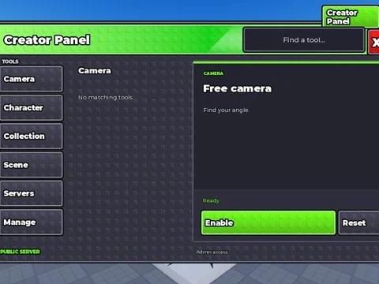

# Steal An Egg – Better Version (clstudioo) – interfaces

66 ScreenGui/éléments extraits du StarterGui de Steal An Egg – Better Version (clstudioo) (un .rbxm par enfant).

- **Catégorie** : [Interfaces](../Interfaces.md)
- **Sous-catégorie** : [Interfaces de jeux](Interfaces%20de%20jeux.md)
- **Type** : Interface (ScreenGui)
- **Contenu** : 66 fichiers · 1,2 Mo
- **Jeu d'origine** : Steal An Egg
- **Fichier source** : `Assets/ui/FromGames/Steal An Egg Better Version clstudioo` (dans le vault)

## Fichiers (66)

- `ActivePets.rbxm`
- `AreaGui.rbxm`
- `AssetEggData.rbxm`
- `AssetHoverData.rbxm`
- `AutoSell.rbxm`
- `BackpackGui.rbxm`
- `BossFightUI.rbxm`
- `BossMastery.rbxm`
- `BossShop.rbxm`
- `BossSpawningCountdown.rbxm`
- `BottomUI.rbxm`
- `CaptureTheEggUI.rbxm`
- `Cmdr.rbxm`
- `ContentCreatorsAdminPanel.rbxm`
- `CountdownGui.rbxm`
- `CrateOpeningPopUpFrame.rbxm`
- `CutsceneUI.rbxm`
- `DragonEggEventUI.rbxm`
- `DropHeldEgg.rbxm`
- `Fade.rbxm`
- `FreeGift.rbxm`
- `GenericRewardScreen2.rbxm`
- `GetMoreSpeedOnHit.rbxm`
- `GreatBloomBanner.rbxm`
- `GrowingEggs.rbxm`
- `HUD.rbxm`
- `Index.rbxm`
- `LightVsDarknessUI.rbxm`
- `Message.rbxm`
- `MonsterChargeUI.rbxm`
- `MonsterChestRewards.rbxm`
- `MonsterEventTutorialFrame.rbxm`
- `MonsterEventUI.rbxm`
- `Notifications.rbxm`
- `OfflineMoneyInPlot.rbxm`
- `OverlayUI.rbxm`
- `PendingPurchase.rbxm`
- `PetFuse.rbxm`
- `PhoneVideoUI.rbxm`
- `PopupPrompt.rbxm`
- `RecoveryVignette.rbxm`
- `RescueDragonFTUEQuest.rbxm`
- `ResetStartTimer.rbxm`
- `RiftTradeIn.rbxm`
- `RobuxShop.rbxm`
- `RollbackRewardUI.rbxm`
- `RunBackEffects.rbxm`
- `SakuraCrystalCounter.rbxm`
- `SakuraEggCharge.rbxm`
- `SakuraEventTutorialFrame.rbxm`
- `SellPrompt.rbxm`
- `Settings.rbxm`
- `ShiftLockButton.rbxm`
- `SpeedGainAnimation.rbxm`
- `SpeedShop.rbxm`
- `StaticTreadmillImageSurfaceGui.rbxm`
- `TrailShop.rbxm`
- `TreadmillScreenButtonShare.rbxm`
- `TreadmillScreenButtonSwapLeft.rbxm`
- `TreadmillScreenButtonSwapRight.rbxm`
- `TreadmillScreenComments.rbxm`
- `TreadmillScreenFriendLikes.rbxm`
- `TreadmillScreenSideButtons.rbxm`
- `TreadmillVideoSurfaceGui.rbxm`
- `TutorialClick.rbxm`
- `TutorialInstructions.rbxm`
