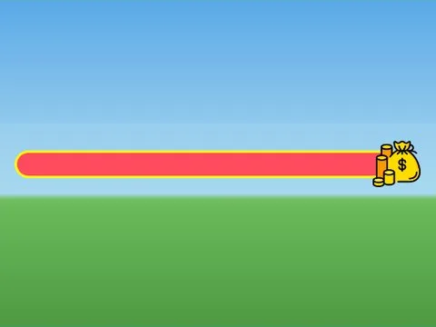

# UI · Cashgrab Bridge

Interface « UI » du jeu Cashgrab Bridge. 2 éléments UI.

- **Catégorie** : [Interfaces](../Interfaces.md)
- **Sous-catégorie** : [Interfaces de jeux](Interfaces%20de%20jeux.md)
- **Type** : Interface (ScreenGui)
- **Contenu** : 2 éléments UI
- **Jeu d'origine** : Cashgrab Bridge
- **Fichier source** : `Assets/ui/FromGames/CashgrabBridgeEU/UI.rbxm` (dans le vault)
