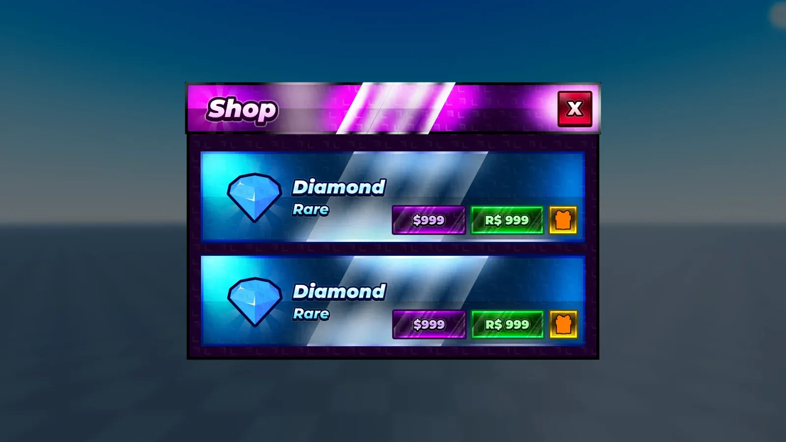

# Anime Stud Shop UI

Maquette Figma « Anime Stud Shop UI » : 4 frames. Le .fig s’ouvre dans Figma (glisser le fichier dans Figma).

- **Catégorie** : [Interfaces](../Interfaces.md)
- **Sous-catégorie** : [Maquettes Figma](Maquettes%20Figma.md)
- **Type** : Maquette Figma
- **Fichier source** : `Assets/ui/Figma/Anime-Stud Shop UI.fig` (dans le vault)

## Maquette

### Page entière

### BaseplateBackground

### MainFrame

### Header

### Container

