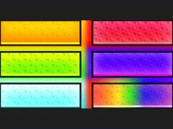
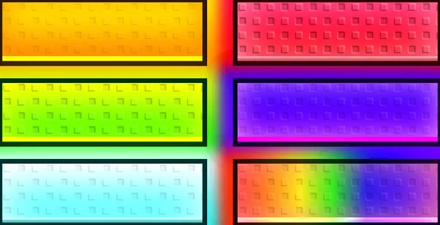

# Buttons

Maquette Figma « Buttons » : 1 frame. Le .fig s’ouvre dans Figma (glisser le fichier dans Figma).

- **Catégorie** : [Interfaces](../Interfaces.md)
- **Sous-catégorie** : [Maquettes Figma](Maquettes%20Figma.md)
- **Type** : Maquette Figma
- **Fichier source** : `Assets/ui/Figma/Buttons.fig` (dans le vault)

## Maquette

### Page entière

