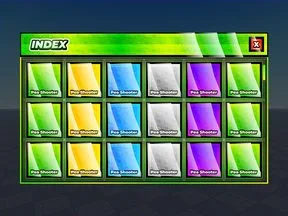
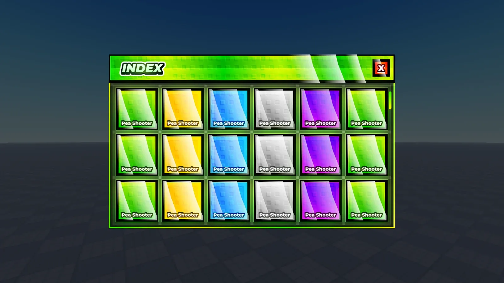
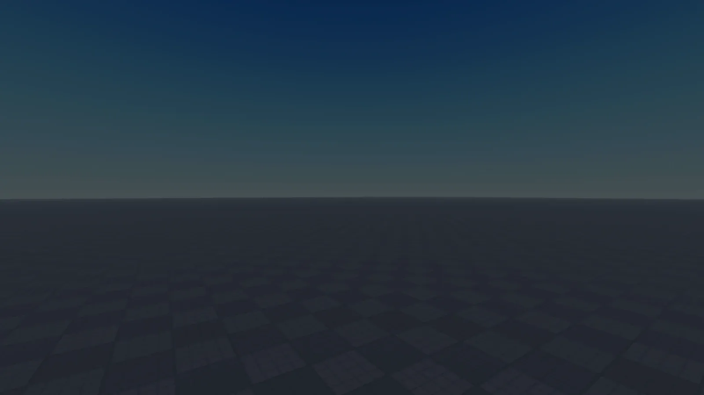
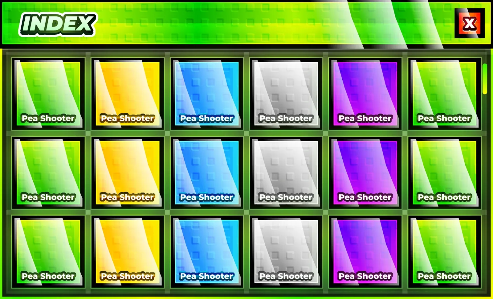

# Indexx

Maquette Figma « Indexx » : 2 frames. Le .fig s’ouvre dans Figma (glisser le fichier dans Figma).

- **Catégorie** : [Interfaces](../Interfaces.md)
- **Sous-catégorie** : [Maquettes Figma](Maquettes%20Figma.md)
- **Type** : Maquette Figma
- **Fichier source** : `Assets/ui/Figma/Indexx.fig` (dans le vault)

## Maquette

### Page entière

### Background

### Index

