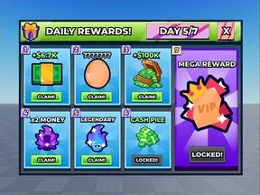

# Maquettes Figma

Sous-catégorie de [Interfaces](../Interfaces.md) · **11 éléments**

| Aperçu | Élément | Infos |
| --- | --- | --- |
|  | [Anime Stud Shop UI](Anime%20Stud%20Shop%20UI.md) | Maquette Figma |
|  | [Buttons](Buttons.md) | Maquette Figma |
|  | [Codes v1 Purple](Codes%20v1%20Purple.md) | Maquette Figma |
|  | [Codes v2 Blue](Codes%20v2%20Blue.md) | Maquette Figma |
|  | [Indexx](Indexx.md) | Maquette Figma |
|  | [OS2File](OS2File.md) | Maquette Figma |
|  | [Rebirth UI](Rebirth%20UI.md) | Maquette Figma |
|  | [Rewards](Rewards.md) | Maquette Figma |
|  | [Starter Frames Free Pack](Starter%20Frames%20Free%20Pack.md) | Maquette Figma |
|  | [Stud frame templates](Stud%20frame%20templates.md) | Maquette Figma |
|  | [Wtever](Wtever.md) | Maquette Figma |
