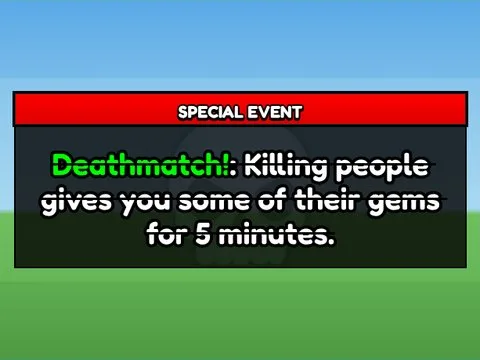

# Special Event · Punch Simulator

Interface « Special Event » du jeu Punch Simulator. 6 éléments UI.

- **Catégorie** : [Interfaces](../Interfaces.md)
- **Sous-catégorie** : [Notifications & popups](Notifications%20&%20popups.md)
- **Type** : Interface (ScreenGui)
- **Contenu** : 6 éléments UI
- **Jeu d'origine** : Punch Simulator
- **Fichier source** : `ui/ByType/Notifications_Popups/PunchSim_SpecialEvent.rbxm` (dans ta bibliothèque `rblx\lib`)
