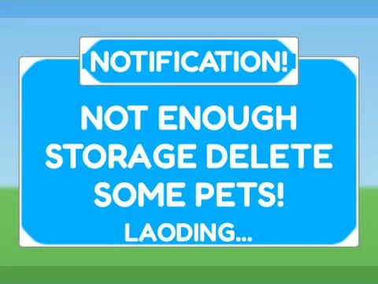

# Warnings · Hatching Simulator

Interface « Warnings » du jeu Hatching Simulator. 8 éléments UI.

- **Catégorie** : [Interfaces](../Interfaces.md)
- **Sous-catégorie** : [Notifications & popups](Notifications%20&%20popups.md)
- **Type** : Interface (ScreenGui)
- **Contenu** : 8 éléments UI
- **Jeu d'origine** : Hatching Simulator
- **Fichier source** : `ui/ByType/Notifications_Popups/HatchingSim_Warnings.rbxm` (dans ta bibliothèque `rblx\lib`)
