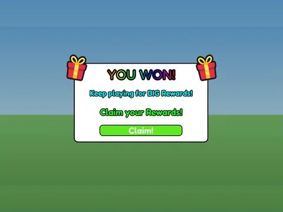

# Win Screen · Glass Bridge

Interface « Win Screen » du jeu Glass Bridge. 9 éléments UI.

- **Catégorie** : [Interfaces](../Interfaces.md)
- **Sous-catégorie** : [Notifications & popups](Notifications%20&%20popups.md)
- **Type** : Interface (ScreenGui)
- **Contenu** : 9 éléments UI
- **Jeu d'origine** : Glass Bridge
- **Fichier source** : `Assets/ui/ByType/Notifications_Popups/GlassBridge_WinScreen.rbxm` (dans le vault)
