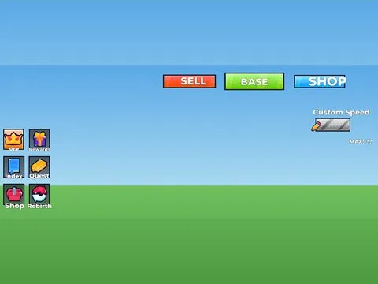

# MAINHUDK4LSH

Interface « MAINHUDK4LSH ». 50 éléments UI.

- **Catégorie** : [Interfaces](../Interfaces.md)
- **Sous-catégorie** : [Packs UI](Packs%20UI.md)
- **Type** : Interface (ScreenGui)
- **Contenu** : 50 éléments UI
- **Fichier source** : `ui/Roblox Ui Model/MAINHUDK4LSH.rbxm` (dans ta bibliothèque `rblx\lib`)
