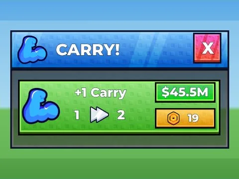
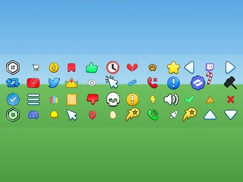

# Packs UI

Sous-catégorie de [Interfaces](../Interfaces.md) · **7 éléments**

| Aperçu | Élément | Infos |
| --- | --- | --- |
|  | [5 frames 4.5k k4lsh](5%20frames%204.5k%20k4lsh.md) | Interface (ScreenGui) · 310 éléments UI |
|  | [Carry frame k4lsh](Carry%20frame%20k4lsh.md) | Interface (ScreenGui) · 26 éléments UI |
|  | [MAINHUDK4LSH](MAINHUDK4LSH.md) | Interface (ScreenGui) · 50 éléments UI |
|  | [Simulator Icons](Simulator%20Icons.md) | Interface (ScreenGui) · 48 éléments UI |
|  | [UI PACK V1](UI%20PACK%20V1.md) | Interface (ScreenGui) · 294 éléments UI |
|  | [Cryptic Games UI Pack](Cryptic%20Games%20UI%20Pack.md) | Pack de fichiers · 4 fichiers · 91 Ko |
|  | [UI Pack (frames, monnaies, barre du bas)](UI%20Pack%20%28frames,%20monnaies,%20barre%20du%20bas%29.md) | Interface (ScreenGui) · 1 fichier · 41 Ko |
