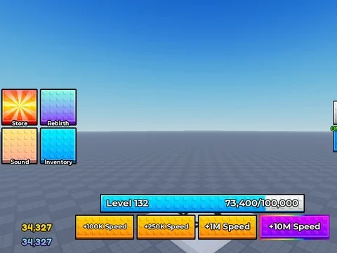

# UI Pack (frames, monnaies, barre du bas)

ScreenGui pack d’interfaces : frames Store, Sound, Rebirth, Inventory, Auras + barre de monnaies et barre du bas.

- **Catégorie** : [Interfaces](../Interfaces.md)
- **Sous-catégorie** : [Packs UI](Packs%20UI.md)
- **Type** : Interface (ScreenGui)
- **Contenu** : 1 fichier · 41 Ko
- **Fichier source** : `Assets/ui/Packs/Ui pack.rbxm` (dans le vault)
