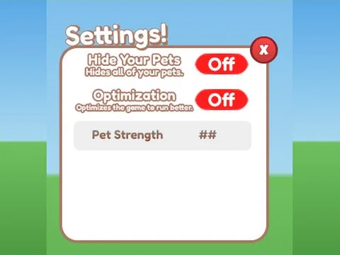
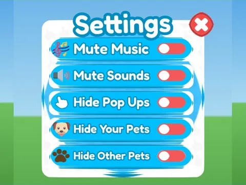
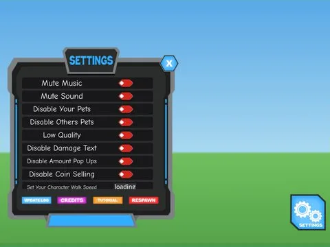

# Paramètres

Sous-catégorie de [Interfaces](../Interfaces.md) · **10 éléments**

| Aperçu | Élément | Infos |
| --- | --- | --- |
|  | [Settings · +1 Jump Every Second](Settings%20%C2%B7%20+1%20Jump%20Every%20Second.md) | Interface (ScreenGui) · 8 éléments UI |
|  | [Settings · First Donations](Settings%20%C2%B7%20First%20Donations.md) | Interface (ScreenGui) · 17 éléments UI |
|  | [Settings · Hatching Simulator](Settings%20%C2%B7%20Hatching%20Simulator.md) | Interface (ScreenGui) · 75 éléments UI |
|  | [Settings · Pet Pharmica](Settings%20%C2%B7%20Pet%20Pharmica.md) | Interface (ScreenGui) · 23 éléments UI |
|  | [Settings · Punch Simulator](Settings%20%C2%B7%20Punch%20Simulator.md) | Interface (ScreenGui) · 31 éléments UI |
|  | [Settings · Rebirth Champions X](Settings%20%C2%B7%20Rebirth%20Champions%20X.md) | Interface (ScreenGui) · 66 éléments UI |
|  | [Settings · Robot Simulator](Settings%20%C2%B7%20Robot%20Simulator.md) | Interface (ScreenGui) · 48 éléments UI |
|  | [Settings · Tapping Lords](Settings%20%C2%B7%20Tapping%20Lords.md) | Interface (ScreenGui) · 51 éléments UI |
|  | [Settings · Training Simulator](Settings%20%C2%B7%20Training%20Simulator.md) | Interface (ScreenGui) · 51 éléments UI |
|  | [Settings · Tweeting Simulator](Settings%20%C2%B7%20Tweeting%20Simulator.md) | Interface (ScreenGui) · 30 éléments UI |
