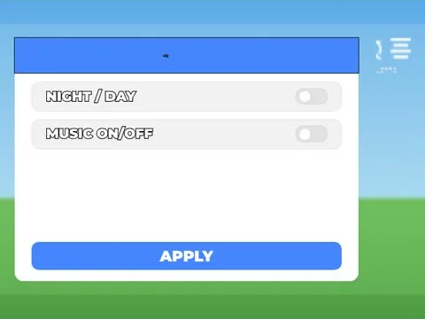

# Settings · First Donations

Interface « Settings » du jeu First Donations. 17 éléments UI.

- **Catégorie** : [Interfaces](../Interfaces.md)
- **Sous-catégorie** : [Paramètres](Param%C3%A8tres.md)
- **Type** : Interface (ScreenGui)
- **Contenu** : 17 éléments UI
- **Jeu d'origine** : First Donations
- **Fichier source** : `Assets/ui/ByType/Settings/FirstDonations_Settings.rbxm` (dans le vault)
