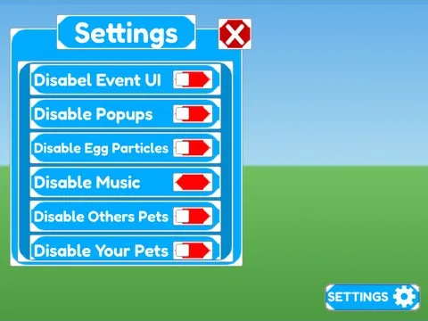

# Settings · Hatching Simulator

Interface « Settings » du jeu Hatching Simulator. 75 éléments UI.

- **Catégorie** : [Interfaces](../Interfaces.md)
- **Sous-catégorie** : [Paramètres](Param%C3%A8tres.md)
- **Type** : Interface (ScreenGui)
- **Contenu** : 75 éléments UI
- **Jeu d'origine** : Hatching Simulator
- **Fichier source** : `ui/ByType/Settings/HatchingSim_Settings.rbxm` (dans ta bibliothèque `rblx\lib`)
