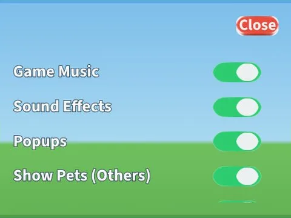

# Settings · Tweeting Simulator

Interface « Settings » du jeu Tweeting Simulator. 30 éléments UI.

- **Catégorie** : [Interfaces](../Interfaces.md)
- **Sous-catégorie** : [Paramètres](Param%C3%A8tres.md)
- **Type** : Interface (ScreenGui)
- **Contenu** : 30 éléments UI
- **Jeu d'origine** : Tweeting Simulator
- **Fichier source** : `Assets/ui/ByType/Settings/TweetingSim_Settings.rbxm` (dans le vault)
