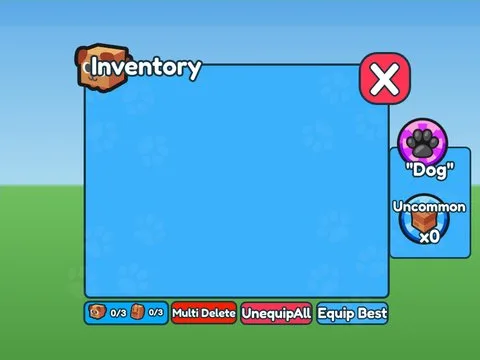

# Pet Inventory · Mining Masters

Interface « Pet Inventory » du jeu Mining Masters. 27 éléments UI.

- **Catégorie** : [Interfaces](../Interfaces.md)
- **Sous-catégorie** : [Pets & inventaire](Pets%20&%20inventaire.md)
- **Type** : Interface (ScreenGui)
- **Contenu** : 27 éléments UI
- **Jeu d'origine** : Mining Masters
- **Fichier source** : `ui/ByType/Pets_Inventory/MiningMasters_PetInventory.rbxm` (dans ta bibliothèque `rblx\lib`)
