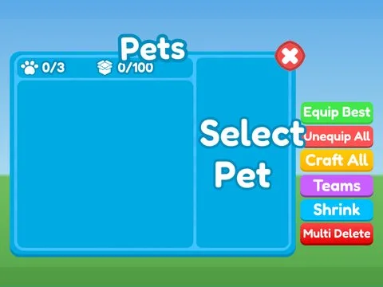

# Pets & inventaire

Sous-catégorie de [Interfaces](../Interfaces.md) · **12 éléments**

| Aperçu | Élément | Infos |
| --- | --- | --- |
|  | [Pet Inventory · Cashgrab Bridge](Pet%20Inventory%20%C2%B7%20Cashgrab%20Bridge.md) | Interface (ScreenGui) · 27 éléments UI |
|  | [Pet Inventory · Mining Masters](Pet%20Inventory%20%C2%B7%20Mining%20Masters.md) | Interface (ScreenGui) · 27 éléments UI |
|  | [Pet Inventory · Pet Pharmica](Pet%20Inventory%20%C2%B7%20Pet%20Pharmica.md) | Interface (ScreenGui) · 9 éléments UI |
|  | [Pet Inventory · Tapping Lords](Pet%20Inventory%20%C2%B7%20Tapping%20Lords.md) | Interface (ScreenGui) · 28 éléments UI |
|  | [Pets · Punch Simulator](Pets%20%C2%B7%20Punch%20Simulator.md) | Interface (ScreenGui) · 40 éléments UI |
|  | [Pets · Rebirth Champions X](Pets%20%C2%B7%20Rebirth%20Champions%20X.md) | Interface (ScreenGui) · 43 éléments UI |
|  | [Pets · Robot Simulator](Pets%20%C2%B7%20Robot%20Simulator%20%C2%B7%20Pets%20&%20inventaire.md) | Interface (ScreenGui) · 20 éléments UI |
|  | [Pets · Training Simulator](Pets%20%C2%B7%20Training%20Simulator%20%C2%B7%20Pets%20&%20inventaire.md) | Interface (ScreenGui) · 18 éléments UI |
|  | [Pets Inventory · Hatching Simulator](Pets%20Inventory%20%C2%B7%20Hatching%20Simulator.md) | Interface (ScreenGui) · 63 éléments UI |
|  | [Pets Inventory Patriot · Hatching Simulator](Pets%20Inventory%20Patriot%20%C2%B7%20Hatching%20Simulator.md) | Interface (ScreenGui) · 73 éléments UI |
|  | [UITemplates · Pet Pharmica](UITemplates%20%C2%B7%20Pet%20Pharmica.md) | Interface (ScreenGui) · 25 éléments UI |
|  | [UITemplates · Tapping Lords](UITemplates%20%C2%B7%20Tapping%20Lords.md) | Interface (ScreenGui) · 16 éléments UI |
