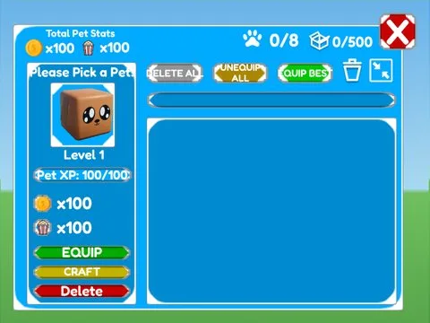

# Pets Inventory Patriot · Hatching Simulator

Interface « Pets Inventory Patriot » du jeu Hatching Simulator. 73 éléments UI.

- **Catégorie** : [Interfaces](../Interfaces.md)
- **Sous-catégorie** : [Pets & inventaire](Pets%20&%20inventaire.md)
- **Type** : Interface (ScreenGui)
- **Contenu** : 73 éléments UI
- **Jeu d'origine** : Hatching Simulator
- **Fichier source** : `ui/ByType/Pets_Inventory/HatchingSim_PetsInventory_Patriot.rbxm` (dans ta bibliothèque `rblx\lib`)
