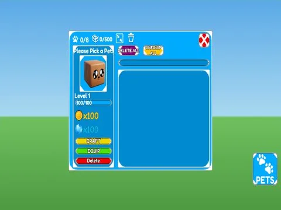

# Pets Inventory · Hatching Simulator

Interface « Pets Inventory » du jeu Hatching Simulator. 63 éléments UI.

- **Catégorie** : [Interfaces](../Interfaces.md)
- **Sous-catégorie** : [Pets & inventaire](Pets%20&%20inventaire.md)
- **Type** : Interface (ScreenGui)
- **Contenu** : 63 éléments UI
- **Jeu d'origine** : Hatching Simulator
- **Fichier source** : `Assets/ui/ByType/Pets_Inventory/HatchingSim_PetsInventory.rbxm` (dans le vault)
