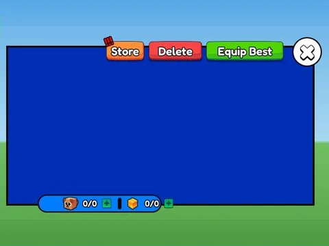

# Pets · Punch Simulator

Interface « Pets » du jeu Punch Simulator. 40 éléments UI.

- **Catégorie** : [Interfaces](../Interfaces.md)
- **Sous-catégorie** : [Pets & inventaire](Pets%20&%20inventaire.md)
- **Type** : Interface (ScreenGui)
- **Contenu** : 40 éléments UI
- **Jeu d'origine** : Punch Simulator
- **Fichier source** : `ui/ByType/Pets_Inventory/PunchSim_Pets.rbxm` (dans ta bibliothèque `rblx\lib`)
