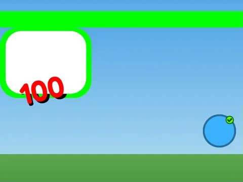

# UITemplates · Pet Pharmica

Interface « UITemplates » du jeu Pet Pharmica. 25 éléments UI.

- **Catégorie** : [Interfaces](../Interfaces.md)
- **Sous-catégorie** : [Pets & inventaire](Pets%20%26%20inventaire.md)
- **Type** : Interface (ScreenGui)
- **Contenu** : 25 éléments UI
- **Jeu d'origine** : Pet Pharmica
- **Fichier source** : `ui/ByType/Pets_Inventory/PetPharmica_UITemplates.rbxm` (dans ta bibliothèque `rblx\lib`)
