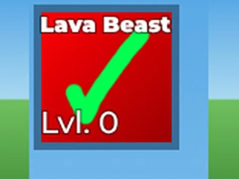

# UITemplates · Tapping Lords

Interface « UITemplates » du jeu Tapping Lords. 16 éléments UI.

- **Catégorie** : [Interfaces](../Interfaces.md)
- **Sous-catégorie** : [Pets & inventaire](Pets%20&%20inventaire.md)
- **Type** : Interface (ScreenGui)
- **Contenu** : 16 éléments UI
- **Jeu d'origine** : Tapping Lords
- **Fichier source** : `ui/ByType/Pets_Inventory/TappingLords_UITemplates.rbxm` (dans ta bibliothèque `rblx\lib`)
