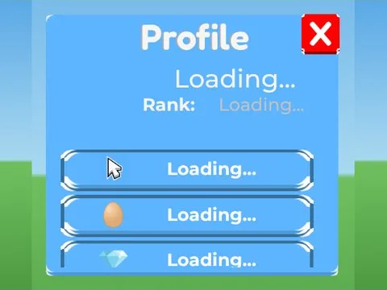

# Profile · Tapping Lords

Interface « Profile » du jeu Tapping Lords. 47 éléments UI.

- **Catégorie** : [Interfaces](../Interfaces.md)
- **Sous-catégorie** : [Profil & stats](Profil%20%26%20stats.md)
- **Type** : Interface (ScreenGui)
- **Contenu** : 47 éléments UI
- **Jeu d'origine** : Tapping Lords
- **Fichier source** : `ui/ByType/Profile_Stats/TappingLords_Profile.rbxm` (dans ta bibliothèque `rblx\lib`)
