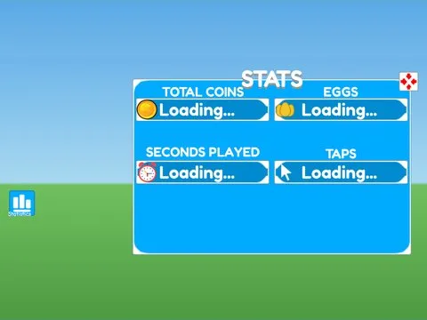

# Stats · Hatching Simulator

Interface « Stats » du jeu Hatching Simulator. 36 éléments UI.

- **Catégorie** : [Interfaces](../Interfaces.md)
- **Sous-catégorie** : [Profil & stats](Profil%20&%20stats.md)
- **Type** : Interface (ScreenGui)
- **Contenu** : 36 éléments UI
- **Jeu d'origine** : Hatching Simulator
- **Fichier source** : `ui/ByType/Profile_Stats/HatchingSim_Stats.rbxm` (dans ta bibliothèque `rblx\lib`)
