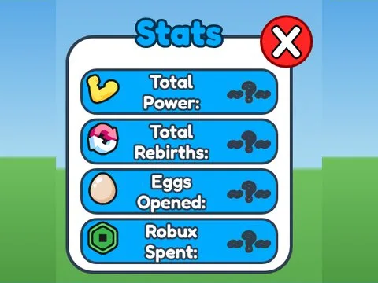

# Stats · Training Simulator

Interface « Stats » du jeu Training Simulator. 22 éléments UI.

- **Catégorie** : [Interfaces](../Interfaces.md)
- **Sous-catégorie** : [Profil & stats](Profil%20&%20stats.md)
- **Type** : Interface (ScreenGui)
- **Contenu** : 22 éléments UI
- **Jeu d'origine** : Training Simulator
- **Fichier source** : `ui/ByType/Profile_Stats/TrainingSim_Stats.rbxm` (dans ta bibliothèque `rblx\lib`)
