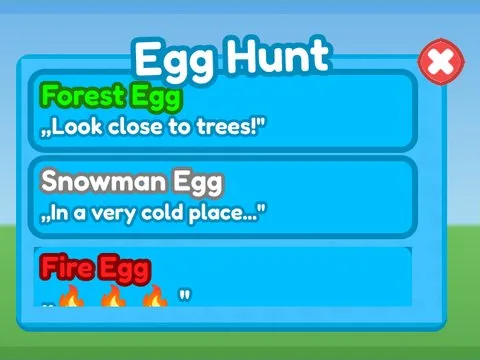

# Season Pass · Rebirth Champions X

Interface « Season Pass » du jeu Rebirth Champions X. 36 éléments UI.

- **Catégorie** : [Interfaces](../Interfaces.md)
- **Sous-catégorie** : [Quêtes & saison](Qu%C3%AAtes%20&%20saison.md)
- **Type** : Interface (ScreenGui)
- **Contenu** : 36 éléments UI
- **Jeu d'origine** : Rebirth Champions X
- **Fichier source** : `Assets/ui/ByType/Quests_Season/RebirthChampionsX_SeasonPass.rbxm` (dans le vault)
