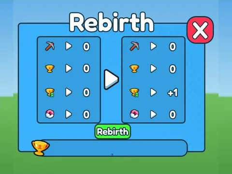
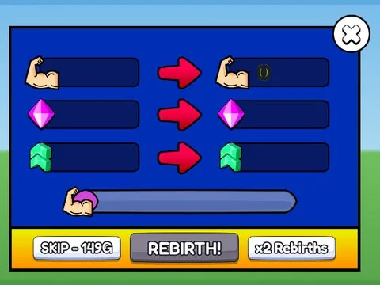
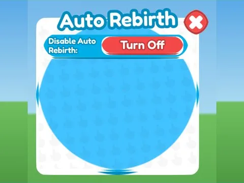
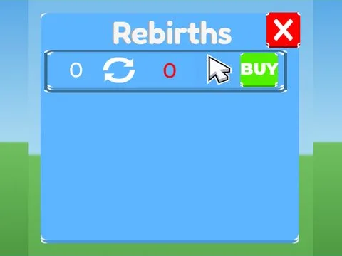

# Rebirth

Sous-catégorie de [Interfaces](../Interfaces.md) · **6 éléments**

| Aperçu | Élément | Infos |
| --- | --- | --- |
|  | [Rebirth · +1 Health Every Second](Rebirth%20%C2%B7%20+1%20Health%20Every%20Second.md) | Interface (ScreenGui) · 11 éléments UI |
|  | [Rebirth · Mining Masters](Rebirth%20%C2%B7%20Mining%20Masters%20%C2%B7%20Rebirth.md) | Interface (ScreenGui) · 43 éléments UI |
|  | [Rebirth · Punch Simulator](Rebirth%20%C2%B7%20Punch%20Simulator.md) | Interface (ScreenGui) · 35 éléments UI |
|  | [Rebirth · Rebirth Champions X](Rebirth%20%C2%B7%20Rebirth%20Champions%20X.md) | Interface (ScreenGui) · 19 éléments UI |
|  | [Rebirth · Tapping Lords](Rebirth%20%C2%B7%20Tapping%20Lords.md) | Interface (ScreenGui) · 18 éléments UI |
|  | [Rebirth · Training Simulator](Rebirth%20%C2%B7%20Training%20Simulator.md) | Interface (ScreenGui) · 15 éléments UI |
