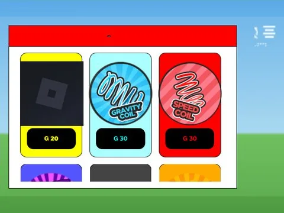

# Game Shop · First Donations

Interface « Game Shop » du jeu First Donations. 52 éléments UI.

- **Catégorie** : [Interfaces](../Interfaces.md)
- **Sous-catégorie** : [Robux & gamepass](Robux%20&%20gamepass.md)
- **Type** : Interface (ScreenGui)
- **Contenu** : 52 éléments UI
- **Jeu d'origine** : First Donations
- **Fichier source** : `ui/ByType/Robux_Gamepass/FirstDonations_GameShop.rbxm` (dans ta bibliothèque `rblx\lib`)
