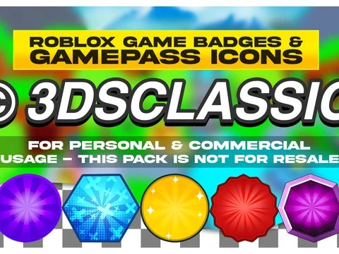

# Gamepass Pack 3DSCLASSIC (PSD)

Fichier Photoshop (25 Mo) « Roblox Game Badges & Gamepass Icons » de 3DSCLASSIC : fonds de badges et d’icônes de gamepass à retoucher puis exporter en PNG. Usage perso et commercial autorisé, revente interdite.

- **Catégorie** : [Interfaces](../Interfaces.md)
- **Sous-catégorie** : [Robux & gamepass](Robux%20&%20gamepass.md)
- **Type** : Pack de fichiers
- **Contenu** : 1 fichier · 25,5 Mo
- **Fichier source** : `Assets/ui/Icons/GampassPack.psd` (dans le vault)
