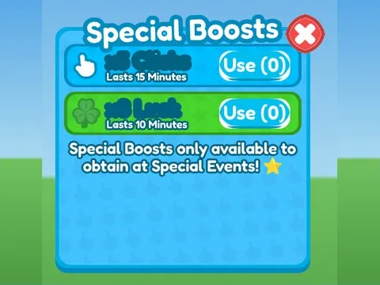

# Gifting Special · Rebirth Champions X

Interface « Gifting Special » du jeu Rebirth Champions X. 33 éléments UI.

- **Catégorie** : [Interfaces](../Interfaces.md)
- **Sous-catégorie** : [Robux & gamepass](Robux%20&%20gamepass.md)
- **Type** : Interface (ScreenGui)
- **Contenu** : 33 éléments UI
- **Jeu d'origine** : Rebirth Champions X
- **Fichier source** : `ui/ByType/Robux_Gamepass/RebirthChampionsX_GiftingSpecial.rbxm` (dans ta bibliothèque `rblx\lib`)
