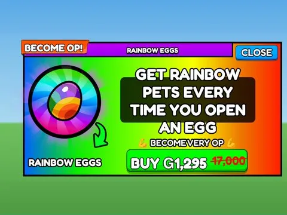

# Rainbow Eggs · Punch Simulator

Interface « Rainbow Eggs » du jeu Punch Simulator. 20 éléments UI.

- **Catégorie** : [Interfaces](../Interfaces.md)
- **Sous-catégorie** : [Robux & gamepass](Robux%20%26%20gamepass.md)
- **Type** : Interface (ScreenGui)
- **Contenu** : 20 éléments UI
- **Jeu d'origine** : Punch Simulator
- **Fichier source** : `ui/ByType/Robux_Gamepass/PunchSim_RainbowEggs.rbxm` (dans ta bibliothèque `rblx\lib`)
