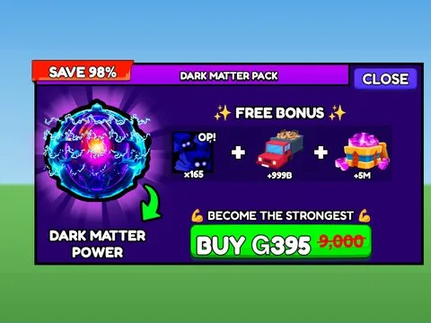
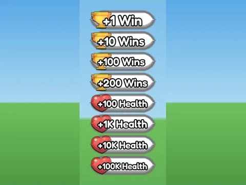
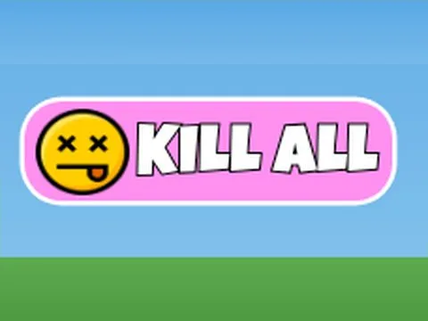
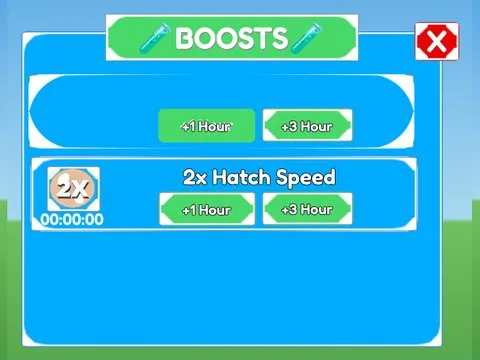
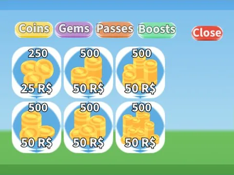

# Robux & gamepass

Sous-catégorie de [Interfaces](../Interfaces.md) · **16 éléments**

| Aperçu | Élément | Infos |
| --- | --- | --- |
|  | [Auto Hatch Pass · Tapping Lords](Auto%20Hatch%20Pass%20%C2%B7%20Tapping%20Lords.md) | Interface (ScreenGui) · 12 éléments UI |
|  | [Boosts Events · Bakery Simulator](Boosts%20Events%20%C2%B7%20Bakery%20Simulator.md) | Interface (ScreenGui) · 41 éléments UI |
|  | [Currency Store · Bakery Simulator](Currency%20Store%20%C2%B7%20Bakery%20Simulator.md) | Interface (ScreenGui) · 24 éléments UI |
|  | [Dark Matter Pack · Punch Simulator](Dark%20Matter%20Pack%20%C2%B7%20Punch%20Simulator.md) | Interface (ScreenGui) · 35 éléments UI |
|  | [Dev Product Buttons · +1 Health Every Second](Dev%20Product%20Buttons%20%C2%B7%20%2B1%20Health%20Every%20Second.md) | Interface (ScreenGui) · 34 éléments UI |
|  | [Donation · Cashgrab Bridge](Donation%20%C2%B7%20Cashgrab%20Bridge.md) | Interface (ScreenGui) · 9 éléments UI |
|  | [Game Shop · First Donations](Game%20Shop%20%C2%B7%20First%20Donations.md) | Interface (ScreenGui) · 52 éléments UI |
|  | [Gamepass Shop · Mining Masters](Gamepass%20Shop%20%C2%B7%20Mining%20Masters.md) | Interface (ScreenGui) · 12 éléments UI |
|  | [Gear Passes · Cashgrab Bridge](Gear%20Passes%20%C2%B7%20Cashgrab%20Bridge.md) | Interface (ScreenGui) · 12 éléments UI |
|  | [Gifting Special · Rebirth Champions X](Gifting%20Special%20%C2%B7%20Rebirth%20Champions%20X.md) | Interface (ScreenGui) · 33 éléments UI |
|  | [Kill All · Cashgrab Bridge](Kill%20All%20%C2%B7%20Cashgrab%20Bridge.md) | Interface (ScreenGui) · 3 éléments UI |
|  | [Rainbow Eggs · Punch Simulator](Rainbow%20Eggs%20%C2%B7%20Punch%20Simulator.md) | Interface (ScreenGui) · 20 éléments UI |
|  | [Robux Boosts · Hatching Simulator](Robux%20Boosts%20%C2%B7%20Hatching%20Simulator.md) | Interface (ScreenGui) · 40 éléments UI |
|  | [Robux Shop · Tweeting Simulator](Robux%20Shop%20%C2%B7%20Tweeting%20Simulator.md) | Interface (ScreenGui) · 58 éléments UI |
|  | [Shop Gui · Billionaire Tycoon](Shop%20Gui%20%C2%B7%20Billionaire%20Tycoon%20%C2%B7%20Robux%20%26%20gamepass.md) | Interface (ScreenGui) · 74 éléments UI |
|  | [Troll Products · Cashgrab Bridge](Troll%20Products%20%C2%B7%20Cashgrab%20Bridge.md) | Interface (ScreenGui) · 17 éléments UI |
