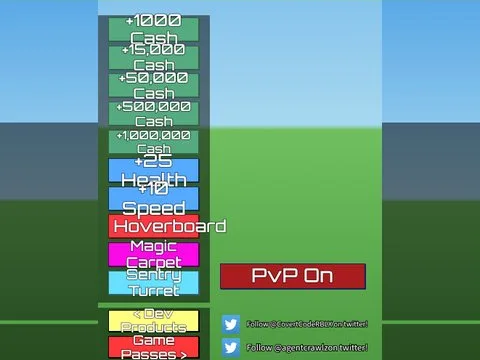

# Shop Gui · Billionaire Tycoon

Interface « Shop Gui » du jeu Billionaire Tycoon. 74 éléments UI.

- **Catégorie** : [Interfaces](../Interfaces.md)
- **Sous-catégorie** : [Robux & gamepass](Robux%20&%20gamepass.md)
- **Type** : Interface (ScreenGui)
- **Contenu** : 74 éléments UI
- **Jeu d'origine** : Billionaire Tycoon
- **Fichier source** : `ui/ByType/Robux_Gamepass/BillionaireTycoon_ShopGui.rbxm` (dans ta bibliothèque `rblx\lib`)
