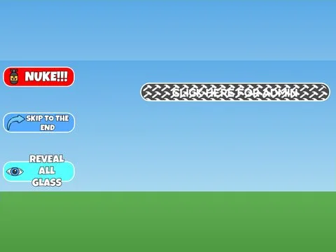

# Troll Products · Cashgrab Bridge

Interface « Troll Products » du jeu Cashgrab Bridge. 17 éléments UI.

- **Catégorie** : [Interfaces](../Interfaces.md)
- **Sous-catégorie** : [Robux & gamepass](Robux%20&%20gamepass.md)
- **Type** : Interface (ScreenGui)
- **Contenu** : 17 éléments UI
- **Jeu d'origine** : Cashgrab Bridge
- **Fichier source** : `Assets/ui/ByType/Robux_Gamepass/CashgrabBridge_TrollProducts.rbxm` (dans le vault)
