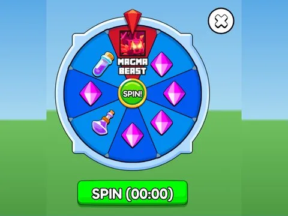

# Roues

Sous-catégorie de [Interfaces](../Interfaces.md) · **3 éléments**

| Aperçu | Élément | Infos |
| --- | --- | --- |
|  | [Spin Wheel Full · Lib perso](Spin%20Wheel%20Full%20%C2%B7%20Lib%20perso.md) | Interface (ScreenGui) · 80 éléments UI |
|  | [Spinner · Glass Bridge](Spinner%20%C2%B7%20Glass%20Bridge.md) | Interface (ScreenGui) · 27 éléments UI |
|  | [Wheel · Punch Simulator](Wheel%20%C2%B7%20Punch%20Simulator.md) | Interface (ScreenGui) · 37 éléments UI |
