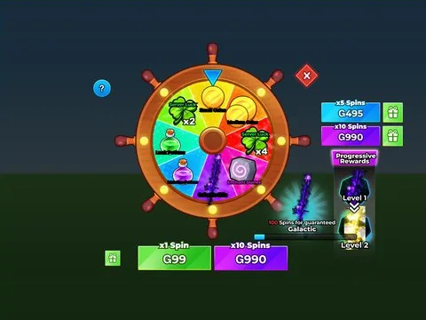

# Spin Wheel Full · Lib perso

Interface « Spin Wheel Full » du jeu Lib perso. 80 éléments UI.

- **Catégorie** : [Interfaces](../Interfaces.md)
- **Sous-catégorie** : [Roues](Roues.md)
- **Type** : Interface (ScreenGui)
- **Contenu** : 80 éléments UI
- **Jeu d'origine** : Lib perso
- **Fichier source** : `Assets/ui/ByType/SpinWheel/Lib_SpinWheel_Full.rbxm` (dans le vault)
