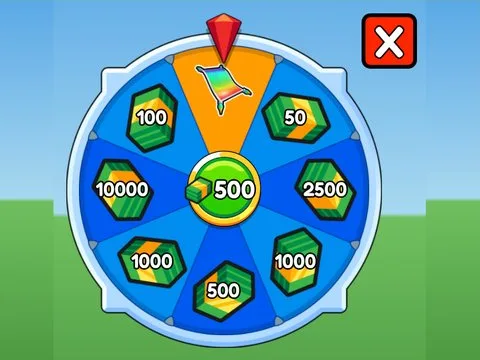

# Spinner · Glass Bridge

Interface « Spinner » du jeu Glass Bridge. 27 éléments UI.

- **Catégorie** : [Interfaces](../Interfaces.md)
- **Sous-catégorie** : [Roues](Roues.md)
- **Type** : Interface (ScreenGui)
- **Contenu** : 27 éléments UI
- **Jeu d'origine** : Glass Bridge
- **Fichier source** : `ui/ByType/SpinWheel/GlassBridge_Spinner.rbxm` (dans ta bibliothèque `rblx\lib`)
