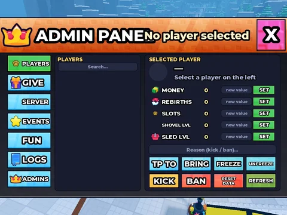

# AdminPanel (Shovel for Eggs)

Panel admin (joueurs, give, serveur, events, logs, admins). Version corrigée et améliorée du 29/10/2026, en vraies instances (style K4 : barres de titre colorées à studs, icônes cartoon, contours noirs).

- **Catégorie** : [Interfaces](../Interfaces.md)
- **Sous-catégorie** : [Shovel for Eggs](Shovel%20for%20Eggs%20%28Interfaces%29.md)
- **Fichier** : `Assets/ui/ShovelForEggs/AdminPanel.rbxm`
- **Scripts liés** : `Projets/ShovelForEggs/src/client/Client/` (contrôleurs UI)
- **Aperçu** : vraie capture dans Roblox Studio (29/10/2026) ; les listes (shop, index, base…) se remplissent en jeu
