# Shovel for Eggs

Sous-catégorie de [Interfaces](../Interfaces.md) · **33 éléments** · toutes les GUI du jeu Shovel for Eggs, corrigées et améliorées (29/10/2026). Le pack complet : `Assets/ui/ShovelForEggs/_StarterGui_COMPLET.rbxm`.

| Aperçu | Élément | Infos |
| --- | --- | --- |
|  | [Advent – menu (Shovel for Eggs)](Advent%20%E2%80%93%20menu%20%28Shovel%20for%20Eggs%29.md) | Calendrier de l’Avent (24 portes, guirlande, jour 24 = pet secret). |
| 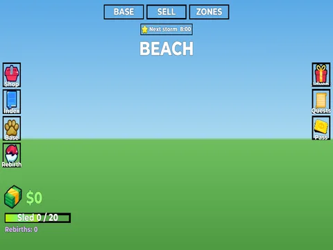 | [Banner – menu (Shovel for Eggs)](Banner%20%E2%80%93%20menu%20%28Shovel%20for%20Eggs%29.md) | Bannière zone / tempête en haut de l’écran. |
| 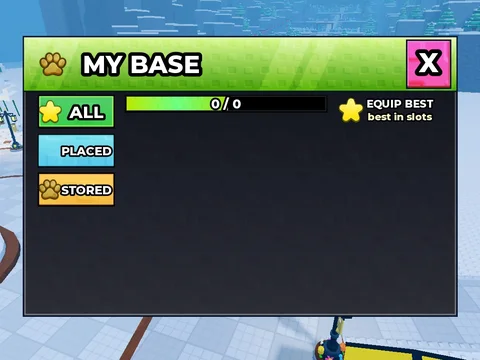 | [Base – menu (Shovel for Eggs)](Base%20%E2%80%93%20menu%20%28Shovel%20for%20Eggs%29.md) | Gestion de la base : pets posés / stockés, Equip Best. |
|  | [Codes – menu (Shovel for Eggs)](Codes%20%E2%80%93%20menu%20%28Shovel%20for%20Eggs%29.md) | Saisie de codes promo. |
| 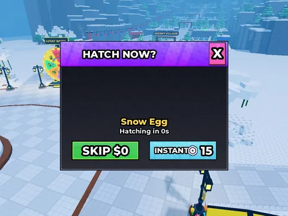 | [EggSkip – menu (Shovel for Eggs)](EggSkip%20%E2%80%93%20menu%20%28Shovel%20for%20Eggs%29.md) | Éclore maintenant (skip en argent ou Robux). |
|  | [Fusion – menu (Shovel for Eggs)](Fusion%20%E2%80%93%20menu%20%28Shovel%20for%20Eggs%29.md) | Machine de fusion : 3 pets → 1 mutation supérieure. |
|  | [GiftSkip – menu (Shovel for Eggs)](GiftSkip%20%E2%80%93%20menu%20%28Shovel%20for%20Eggs%29.md) | Offrir une éclosion à un autre joueur. |
|  | [GroupChest – menu (Shovel for Eggs)](GroupChest%20%E2%80%93%20menu%20%28Shovel%20for%20Eggs%29.md) | Coffre FREE EGG réservé aux membres du groupe. |
|  | [HUD – menu (Shovel for Eggs)](HUD%20%E2%80%93%20menu%20%28Shovel%20for%20Eggs%29.md) | HUD complet : argent, luge, rebirths, boutons gauche / droite, tempête. |
| 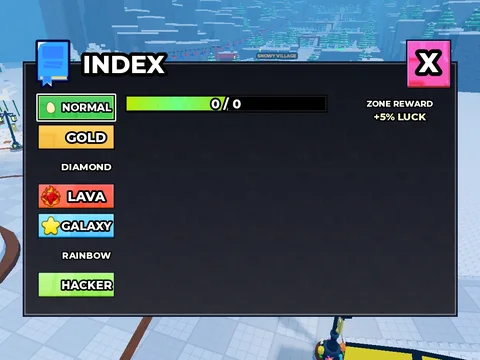 | [Index – menu (Shovel for Eggs)](Index%20%E2%80%93%20menu%20%28Shovel%20for%20Eggs%29.md) | Index des pets par mutation avec barre de progression et récompense. |
|  | [Leaderboard – menu (Shovel for Eggs)](Leaderboard%20%E2%80%93%20menu%20%28Shovel%20for%20Eggs%29.md) | Top joueurs (argent / rebirths). |
| 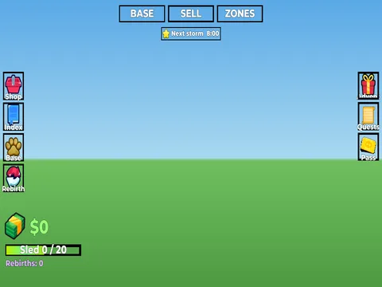 | [Notifications – menu (Shovel for Eggs)](Notifications%20%E2%80%93%20menu%20%28Shovel%20for%20Eggs%29.md) | Notifications en jeu. |
| 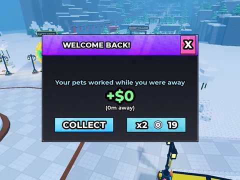 | [Offline – menu (Shovel for Eggs)](Offline%20%E2%80%93%20menu%20%28Shovel%20for%20Eggs%29.md) | Gains hors ligne avec option x2. |
|  | [Pass – menu (Shovel for Eggs)](Pass%20%E2%80%93%20menu%20%28Shovel%20for%20Eggs%29.md) | Winter Pass : 30 paliers, pistes Free / Premium. |
| 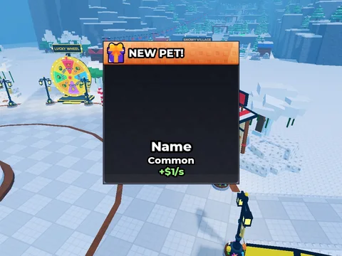 | [Popup – menu (Shovel for Eggs)](Popup%20%E2%80%93%20menu%20%28Shovel%20for%20Eggs%29.md) | Popup « New Pet! » à l’éclosion. |
|  | [Quests – menu (Shovel for Eggs)](Quests%20%E2%80%93%20menu%20%28Shovel%20for%20Eggs%29.md) | Quêtes du jour (3 quêtes + bonus). |
|  | [Rebirth – menu (Shovel for Eggs)](Rebirth%20%E2%80%93%20menu%20%28Shovel%20for%20Eggs%29.md) | Rebirth : multiplicateur avant / après, barre de progression. |
| 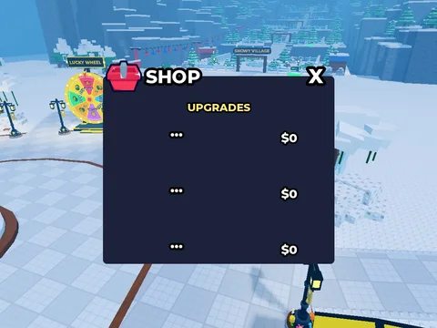 | [Shop – menu (Shovel for Eggs)](Shop%20%E2%80%93%20menu%20%28Shovel%20for%20Eggs%29.md) | Boutique en jeu (upgrades : pelles, luges, clôtures du chalet), cartes texturées. |
|  | [Starter – menu (Shovel for Eggs)](Starter%20%E2%80%93%20menu%20%28Shovel%20for%20Eggs%29.md) | Starter Pack (offre limitée). |
| 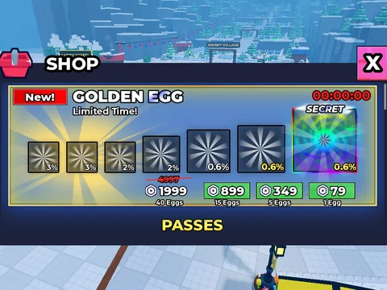 | [Store – menu (Shovel for Eggs)](Store%20%E2%80%93%20menu%20%28Shovel%20for%20Eggs%29.md) | Boutique Robux (œufs, packs d’argent, gamepasses). |
| 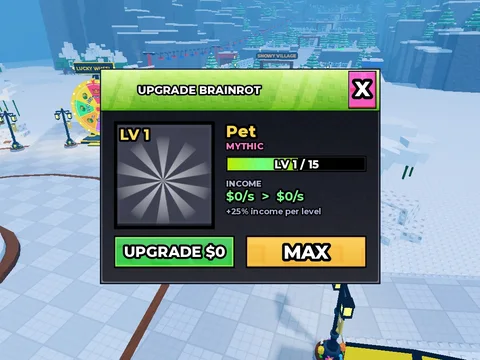 | [Upgrade – menu (Shovel for Eggs)](Upgrade%20%E2%80%93%20menu%20%28Shovel%20for%20Eggs%29.md) | Améliorer un pet (niveau, revenu). |
|  | [AdminPanel (Shovel for Eggs)](AdminPanel%20%28Shovel%20for%20Eggs%29.md) | Panel admin (joueurs, give, serveur, events, logs, admins). |
|  | [GUI (Shovel for Eggs)](GUI%20%28Shovel%20for%20Eggs%29.md) | ScreenGui principal complet (HUD + tous les menus). |
| 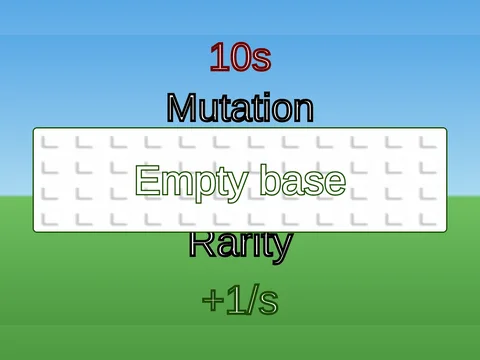 | [GuiTemplates (Shovel for Eggs)](GuiTemplates%20%28Shovel%20for%20Eggs%29.md) | Modèles de GUI (billboards, cartes) clonés par les scripts. |
|  | [Hotbar (Shovel for Eggs)](Hotbar%20%28Shovel%20for%20Eggs%29.md) | Barre d’outils (pelles / œufs) avec ViewportFrames. |
| 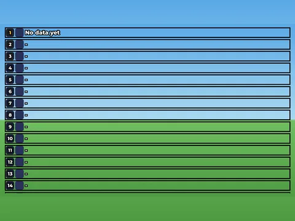 | [LbBoard_Money (Shovel for Eggs)](LbBoard_Money%20%28Shovel%20for%20Eggs%29.md) | Leaderboard 3D argent (SurfaceGui). |
|  | [LbBoard_Rebirths (Shovel for Eggs)](LbBoard_Rebirths%20%28Shovel%20for%20Eggs%29.md) | Leaderboard 3D rebirths (SurfaceGui). |
|  | [PlotTags (Shovel for Eggs)](PlotTags%20%28Shovel%20for%20Eggs%29.md) | Étiquettes des bases des joueurs. |
| 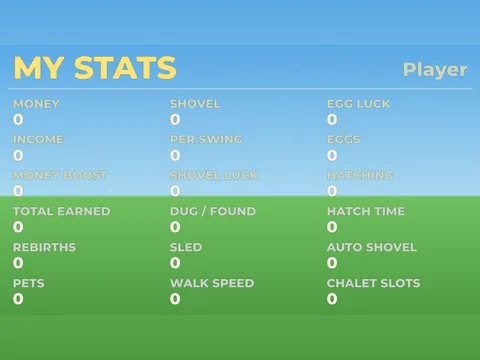 | [StatsBoardGui (Shovel for Eggs)](StatsBoardGui%20%28Shovel%20for%20Eggs%29.md) | Panneau 3D des stats (SurfaceGui). |
|  | [StormFx (Shovel for Eggs)](StormFx%20%28Shovel%20for%20Eggs%29.md) | Effets écran des tempêtes (givre, or, flash). |
|  | [Tutorial (Shovel for Eggs)](Tutorial%20%28Shovel%20for%20Eggs%29.md) | Tutoriel : bienvenue, cartes, pointeur, confettis. |
| 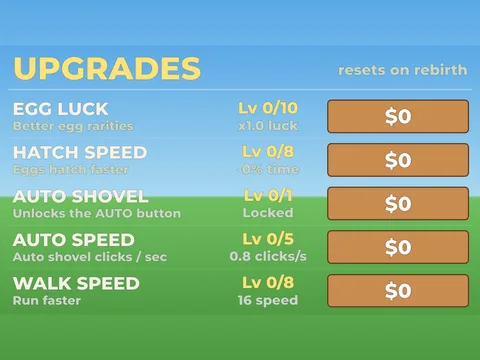 | [UpgradeBoardGui (Shovel for Eggs)](UpgradeBoardGui%20%28Shovel%20for%20Eggs%29.md) | Panneau 3D des upgrades (SurfaceGui). |
|  | [WheelWin (Shovel for Eggs)](WheelWin%20%28Shovel%20for%20Eggs%29.md) | Écran de gain de la roue (rayons, confettis). |
