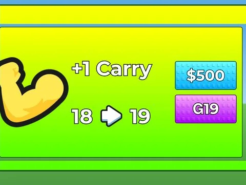

# Carry Template

Interface « Carry Template ». 20 éléments UI.

- **Catégorie** : [Interfaces](../Interfaces.md)
- **Sous-catégorie** : [Steal an Spooky Egg](Steal%20an%20Spooky%20Egg%20%28Interfaces%29.md)
- **Type** : Interface (ScreenGui)
- **Contenu** : 20 éléments UI
- **Fichier source** : `Assets/ui/SpookyGame/Templates/CarryTemplate.rbxm` (dans le vault)
